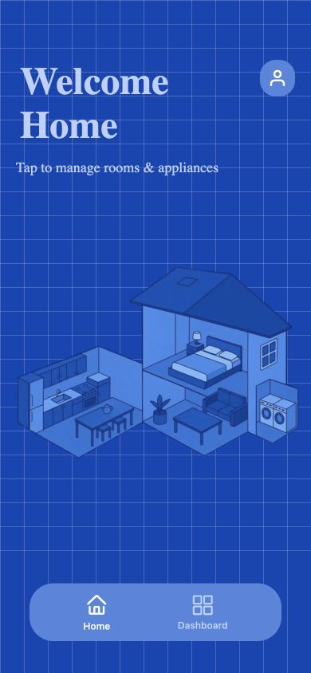
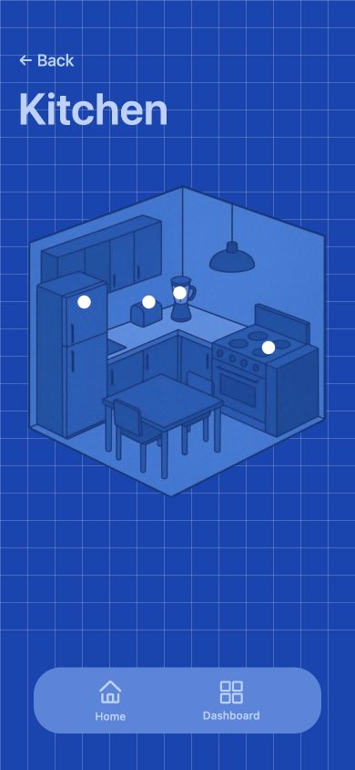
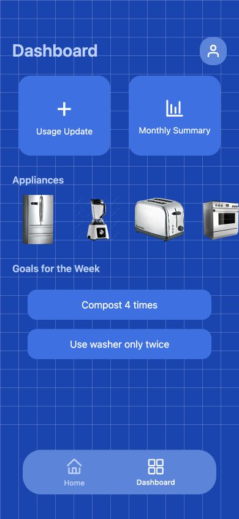

# EcoGrid

A household sustainability app for organizing appliances by room, recording usage, and comparing appliance models. Built from scratch by **Rishav Gadiyar** using React Native, Expo, TypeScript, and Firebase.

The original repository was hosted under another account. This repository preserves that project history and presents my implementation.

## App preview

Screenshots from the local Expo web app at a 390 × 844 mobile viewport.

| Home | Kitchen | Dashboard |
|---|---|---|
|  |  |  |

## Features

- Room-based navigation for kitchen, bedroom, living room, and laundry appliances.
- Email/password signup and login through Firebase Authentication.
- User-specific appliance selections stored in Cloud Firestore.
- Appliance catalogs for televisions, air conditioners, and downlights, with recommendations based on lower catalog energy or power values within each category.
- Usage-entry forms that save appliance names and durations locally by selected month using AsyncStorage.
- A dashboard, appliance comparison views, and a chart summarizing saved appliance catalog values.

## Technical design

`App.js` loads `navigation/StackNavigator.tsx`, which defines the app's screen flow. Room and dashboard screens lead to the appliance modal, where catalog records are read from JSON and selected models are saved under the authenticated user's Firestore document.

Usage entries use device-local AsyncStorage. The summary chart reads the Firestore appliance selections. These are separate data paths in the current implementation.

| Component | Technology |
|---|---|
| UI and navigation | React Native, Expo, React Navigation |
| Typed screens and components | TypeScript |
| Authentication | Firebase Authentication |
| Appliance persistence | Cloud Firestore |
| Local usage persistence | AsyncStorage |
| Charts | react-native-chart-kit |
| Appliance catalog | JSON datasets with ENERGY STAR model identifiers |

## Run locally

```sh
git clone https://github.com/rishgad/EcoGrid.git
cd EcoGrid
npm ci
npm start
```

Use an Expo-compatible device or simulator. The repository also provides `npm run android` and `npm run ios` launch scripts.

Configure `firebase.ts` for your own Firebase project, enable email/password authentication, and configure Firestore access for authenticated user documents. Review the included Firestore rules before using a deployment with real user data.

For the browser preview, run:

```sh
npm run web
```

The local web app has been checked at a mobile viewport for Home, Kitchen, and Dashboard navigation. Appliance persistence and account flows require Firebase configuration and authentication. The app has not been publicly deployed.

## Project structure

| Path | Purpose |
|---|---|
| `screens/` | Room views, authentication, dashboard, usage entry, and summaries |
| `components/AppliancePopup.tsx` | Model selection, appliance details, and recommendations |
| `navigation/StackNavigator.tsx` | Active navigation configuration |
| `JSONs/` | Appliance catalog records |
| `firebase.ts` | Firebase initialization |
| `assets/` | App and appliance images |

## Current limitations

The summary chart aggregates catalog values from saved appliances; selecting a month does not currently filter those values, and it does not derive measured energy use from the local usage-entry forms. Some comparison values are fixed placeholders, and the month selector uses a fixed date range.

Catalog fields use different units across appliance categories. A combined chart should therefore not be interpreted as a normalized household energy total. Recommendations compare catalog values, rather than predicting savings from actual household behavior.

These limitations are visible development priorities. The project does not currently demonstrate measured energy savings or integration with live energy meters.
